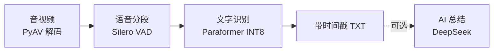

# 本地音频转文字

将单个音频或视频转成带时间戳的中文 TXT，支持图形界面和命令行。转写在本机 CPU 上完成，音视频无需上传。可选的 AI 总结通过 DeepSeek 处理，会发送所选文本。

## 目录结构

```text
Audio_To_Txt/
├── README.md                 // 项目说明与使用方法
├── transcribe_paraformer.py  // 转写核心，负责音轨读取、语音检测与识别，支持命令行
├── transcribe_gui.py         // 图形界面入口，调用转写核心，提供模型下载、设置与 AI 总结
├── assets/                   // 程序图标与 README 图片
├── packaging/                // 含模型版与轻量版的 Windows 打包配置
└── .gitignore                // Git 忽略规则
```

## 技术流程



音轨统一为 16 kHz 单声道，检测后合并相邻片段，再由 sherpa-onnx 逐段识别。AI 总结也可导入已有 TXT 或 Markdown。

## 效果展示

转写结果按语音片段排列，每段包含开始时间和识别文字。以下为输出格式示例，内容为示意。

```text
00:00:03
今天我们讨论一下项目的开发进度。

00:00:12
音频转写功能已经完成，接下来完善界面和使用说明。

00:00:24
下周安排一次测试，收集大家的反馈。
```

## 快速使用

### 直接运行 Windows 程序

如果已有 `dist/` 发布包，解压 ZIP 后双击其中的 EXE，无需安装 Python。

- `AudioToTxt-win64.zip` 包含模型，解压后即可转写。
- `AudioToTxt-no-models-win64.zip` 为轻量版，首次使用需到“设置”下载 Paraformer 和 Silero VAD。

### 从源码运行

需要 Windows 和 Python 3.12。在项目目录打开 PowerShell，首次使用执行以下命令。已有可用 `.venv` 时可直接运行最后一行。

```powershell
py -3.12 -m venv .venv
.\.venv\Scripts\python.exe -m pip install av==15.1.0 numpy==2.5.4 sherpa-onnx==2.0.0 tkinterdnd2==0.6.4
.\.venv\Scripts\python.exe .\transcribe_gui.py
```

1. 首次启动时，如模型未就绪，到“设置”下载两个模型。
2. 选择或拖入一个音频、视频文件，点击“开始转写”。
3. 结果默认保存为输入文件同目录、同名的 `.txt`，也可修改输出路径。同名结果文件会被覆盖。

需要 AI 总结时，在“设置”填写自己的 DeepSeek API Key，再选择 TXT 或 Markdown 文件生成总结。Key 和提示词保存在程序目录的 `settings.json` 中。

### 命令行转写

准备好模型后运行，可通过 `--help` 查看全部参数。

```powershell
.\.venv\Scripts\python.exe .\transcribe_paraformer.py ".\meeting.mp3"
# 自定义输出路径和 CPU 线程数
.\.venv\Scripts\python.exe .\transcribe_paraformer.py ".\meeting.mp4" -o ".\output\meeting.txt" --threads 6
```

<details>
<summary>重新打包 Windows 程序</summary>

在项目根目录打开 PowerShell，使用 `packaging/` 中的配置执行打包。

```powershell
.\.venv\Scripts\python.exe -m pip install pyinstaller
.\.venv\Scripts\pyinstaller.exe --clean --noconfirm .\packaging\AudioToTxt.spec
.\.venv\Scripts\pyinstaller.exe --clean --noconfirm .\packaging\AudioToTxtLite.spec
```

含模型版打包前需先准备好 `models/` 下的模型。

</details>
