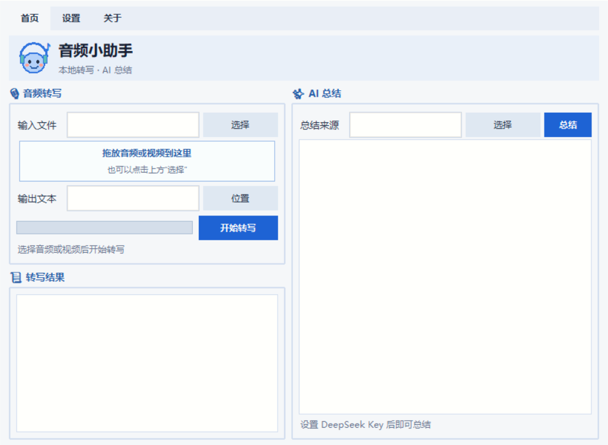
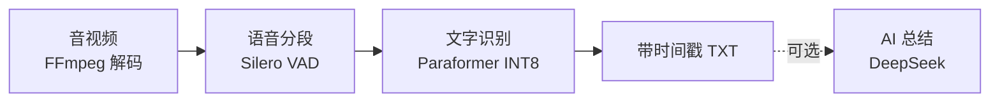

# 本地音频转文字

将单个音频或视频快速转成带时间戳的中文 TXT，支持图形界面和命令行。

- **本地运行，保护隐私**。转写全程在本机 CPU 上完成，音视频无需上传，转写结果保存在本地。模型准备好后即可离线转写。
- **快速处理长音频**。本机样本实测约 **27.7 倍速**，按该样本换算，**1 小时同类音频约需 2 分 10 秒**。
- **AI 总结，提炼重点**。支持通过 DeepSeek 总结转写内容或导入的文本，可自定义提示词，按需启用。启用后会将所选文本发送给 DeepSeek。

## 效果展示



转写结果按语音片段排列，每段包含开始时间和识别文字。以下为输出格式示例，内容为示意。

```text
00:00:03
今天我们讨论一下项目的开发进度。

00:00:12
音频转写功能已经完成，接下来完善界面和使用说明。

00:00:24
下周安排一次测试，收集大家的反馈。
```

## 目录结构

```text
Audio_To_Txt/
├── README.md                 // 项目说明与使用方法
├── LICENSE                   // GPL-3.0 开源协议
├── transcribe_paraformer.py  // 转写核心，负责音轨读取、语音检测与识别，支持命令行
├── transcribe_gui.py         // 图形界面入口，调用转写核心，提供模型下载、设置与 AI 总结
├── assets/                   // 程序图标、精简 FFmpeg 与 README 图片
├── packaging/                // Windows 打包配置与 FFmpeg 构建脚本
├── docs/                     // 体积缩减思路、过程与问题记录
└── .gitignore                // Git 忽略规则
```

## 技术流程



音轨统一为 16 kHz 单声道，检测后合并相邻片段，再由 sherpa-onnx 逐段识别。AI 总结也可导入已有 TXT 或 Markdown。

### 转写速度

程序按原始时间轴离线识别，处理倍速由“音视频时长 ÷ 实际耗时”计算。本机使用 Intel Core i7-10750H、默认 4 个识别线程，单次实测转写 26 分 38 秒的 MP3 耗时约 58 秒，约 **27.7 倍速**。按该样本换算，**1 小时同类音频约需 2 分 10 秒**。

视频同样读取音轨进行识别。实际耗时随 CPU 性能、语音占比和文件编码变化，可参考界面中的预计总耗时。上述计时覆盖音轨读取、模型加载、语音检测与识别，模型下载和 AI 总结另计。


## 快速使用

### 直接运行 Windows 程序

下载 Windows 发布包，解压 ZIP 后双击其中的 EXE 即可运行。[下载 v1.0.1](https://github.com/lgem2008/Audio_To_Txt/releases/tag/v1.0.1)

- `AudioToTxt_win64.zip` 约 **106.5 MiB**，包含模型，解压后即可转写。
- `AudioToTxt_win64_Lite.zip` 约 **34.3 MiB**，首次使用需到“设置”下载 Paraformer 和 Silero VAD。

### 从源码运行

需要 Windows x64 和 Python 3.12。在项目目录打开 PowerShell，首次使用执行以下命令。已有可用 `.venv` 时可直接运行最后一行。

```powershell
py -3.12 -m venv .venv
.\.venv\Scripts\python.exe -m pip install numpy==2.5.4 sherpa-onnx==2.0.0 tkinterdnd2==0.6.4
.\.venv\Scripts\python.exe .\transcribe_gui.py
```

1. 首次启动时，如模型未就绪，到“设置”下载两个模型。
2. 选择或拖入一个音频、视频文件，点击“开始转写”。
3. 结果默认保存为输入文件同目录、同名的 `.txt`，也可修改输出路径。同名结果文件会被覆盖。

需要 AI 总结时，在“设置”填写自己的 DeepSeek API Key，再选择 TXT 或 Markdown 文件生成总结。Key 和提示词保存在程序目录的 `settings.json` 中。

源码优先使用 `assets/ffmpeg/ffmpeg.exe`。源码中的 PyAV 兼容回退依赖 `av==15.1.0`。

### 命令行转写

准备好模型后运行，可通过 `--help` 查看全部参数。

```powershell
.\.venv\Scripts\python.exe .\transcribe_paraformer.py ".\meeting.mp3"
# 自定义输出路径和 CPU 线程数
.\.venv\Scripts\python.exe .\transcribe_paraformer.py ".\meeting.mp4" -o ".\output\meeting.txt" --threads 6
```

<details>
<summary>重新打包 Windows 程序</summary>

在项目根目录打开 PowerShell，使用 `packaging/` 中的配置执行打包。

```powershell
.\.venv\Scripts\python.exe -m pip install pyinstaller
.\.venv\Scripts\pyinstaller.exe --clean --noconfirm .\packaging\AudioToTxt.spec
.\.venv\Scripts\pyinstaller.exe --clean --noconfirm .\packaging\AudioToTxtLite.spec
```

含模型版打包前需先准备好 `models/` 下的模型。

精简 FFmpeg 已随源码提供。调整其构建参数后，可使用以下命令重新编译，过程文件保存在 `build/ffmpeg-slim/`。

```powershell
.\.venv\Scripts\python.exe .\packaging\build_ffmpeg.py --jobs 6
```

缩减思路、构建问题和验证结果见 [打包体积缩减记录](docs/打包体积缩减.md)。

</details>

## 开源协议

Copyright (c) 2026 lgem2008。

本项目原创代码采用 GNU General Public License v3.0（GPL-3.0-only，仅第 3 版），协议全文见 [LICENSE](LICENSE)。允许使用、修改和商业分发。分发本项目或其衍生版本时，应遵守 GPL-3.0 的要求，保留版权和许可声明，并向接收者提供对应源码或符合协议要求的源码获取方式。

第三方依赖、模型与随包分发的组件分别遵循其各自的许可协议。
